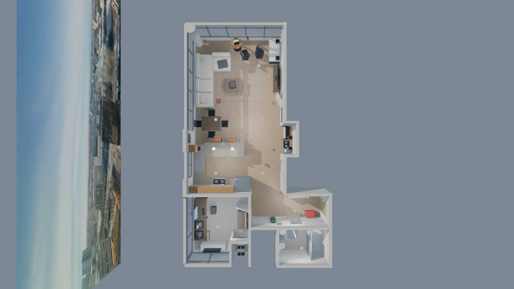
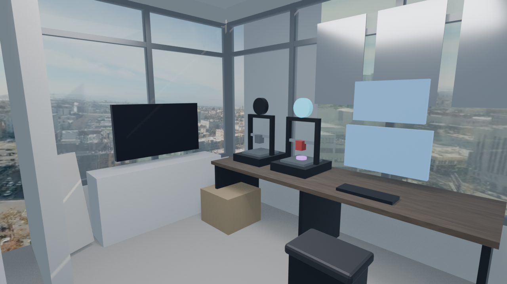
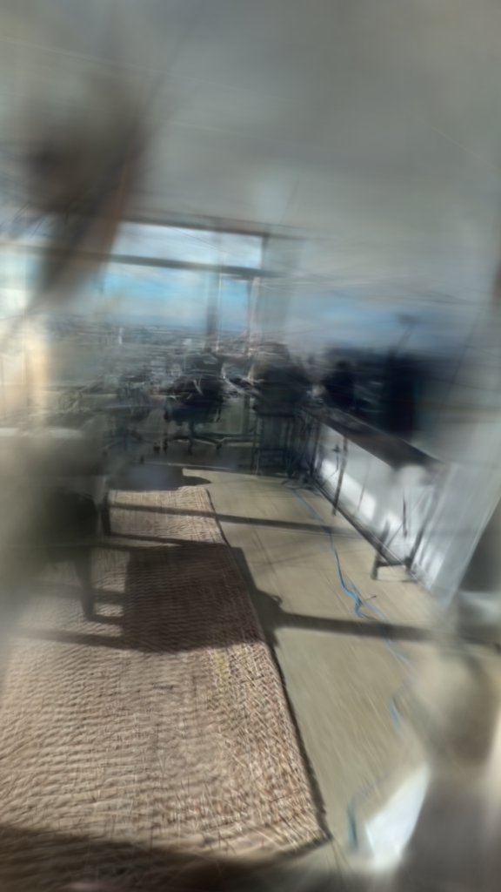

# vaughn-apt

**Hybrid 3D Video Reconstruction, Modular Blender 5.3 Escape-Room Level, Game-Engine Exports, Playable Three.js First-Person Walkthrough, and RTX 5070 3D Gaussian Splat (3DGS)** — built directly from two smartphone apartment walkthrough videos (`IMG_6804.MOV` & `IMG_6805.MOV`).



---

## Visual Tour (Blender 5.3 EEVEE Renders)

| Corner Living Room & Stitched City Skyline | U-Shaped Kitchen, Dining & Real Framed Art |
| :---: | :---: |
|  |  |

| Studio / 3D-Printer Office & Foil Windows | Entry Hallway, Yale Keypad & Bathroom |
| :---: | :---: |
|  |  |

---

## Project Architecture & Pipeline

This project takes raw handheld video and turns it into **four synchronized 3D deliverables** on a local Windows GPU workstation (**NVIDIA RTX 5070 12 GB**, **Blender 5.3**, **FFmpeg**, **pycolmap 4.2.1**, **Brush 3DGS**):

```
IMG_6804.MOV (85s) + IMG_6805.MOV (39s)
        │
        ▼  1. Frame Extraction & Sharpness Filtering (FFmpeg + OpenCV Laplacian)
  496 candidate frames ──► Sharp blur-filtered keyframes + real cropped apartment textures
        │
        ├──► 2A. Structure-from-Motion (pycolmap 4.2.1)
        │         ├─► Gravity-aligned 3D point cloud (living_scan_aligned.ply / living_scan_threejs.json)
        │         ├─► Floorplan & elevation measurements (8.2 m × 13.6 m, ~85 m²)
        │         └─► Brush 3D Gaussian Splatting (RTX 5070 WebGPU) ──► scan/splat/apartment_splat.ply
        │
        └──► 2B. Modular Blender 5.3 Level Generator (scripts/build_apartment_blender.py)
                  ├─► blender/apartment_escape_room.blend   (10 collections, 386 meshes, 45 materials)
                  ├─► exports/apartment_escape_room.glb     (glTF 2.0 w/ 5 embedded apartment textures)
                  ├─► exports/apartment_escape_room.fbx     (FBX w/ embedded textures for Unity/Unreal)
                  └─► web/                                  (Three.js Escape Room + 3DGS Splat Viewer)
```

### Real Cropped Apartment Textures Embedded in the 3D World
Rather than generic placeholders, key hero surfaces were cropped and rectified directly from the source videos and packed into both `.blend` and `.glb`:
- **Panoramic Downtown Skyline** (`textures/skyline_clean.jpg`) — OpenCV panorama stitched from 9 window-pan frames of `IMG_6805.MOV`
- **Woven Jute Living Room Rug** (`textures/tex_rug_clean.jpg`) — shadow-free seamlessly mirror-tiled weave
- **Framed Tattooed-Hands Painting** (`textures/tex_wall_art_clean.jpg`) — real canvas mounted on the dining pier wall
- **Handwritten Hallway Whiteboard** (`textures/tex_whiteboard_clean.jpg`) — real dry-erase notes mounted outside the Music Nook
- **Entryway Vinyl Album Art** (`textures/tex_vinyl_art.jpg`) — leaning on the tufted entryway bench

---

## 3D Reconstruction & Gaussian Splatting (3DGS)

### Structure-from-Motion Floorplan Analysis
`pycolmap 4.2.1` registered **187 / 191** sharp frames across the apartment zones, stitching both videos together across the living room, dining area, music nook, and kitchen, plus recovering the studio office and entry hallway:

| Living/Kitchen SfM Floorplan & Elevation | Multi-Zone Room Comparison |
| :---: | :---: |
|  |  |

### 3D Gaussian Splat (Brush on RTX 5070)
Trained locally with [ArthurBrussee/brush](https://github.com/ArthurBrussee/brush) (`scan/splat/apartment_splat.ply`):



> **Note (v1 baseline):** The initial 8,000-step splat trained on sparse portrait `SIMPLE_RADIAL` frames exhibits blur and edge floaters — see the upcoming v2 commit for the dense pinhole-undistorted, 25,000-step, floater-pruned & gravity-aligned Gaussian Splat upgrade.

---

## Playable First-Person Escape Room (`web/`)

A complete browser-based **Three.js** walkthrough and 4-stage interactive escape room runs directly off `exports/apartment_escape_room.glb`:

### Quick Start
1. Double-click **`launch_walkthrough.bat`** (or run `python -m http.server 8765` from the repo root).
2. Open **`http://localhost:8765/web/`** for the First-Person Escape Room, or **`http://localhost:8765/web/splat.html`** for the 3D Gaussian Splat Viewer.

### Controls
| Key / Input | Action |
| :--- | :--- |
| `W A S D` / Arrow Keys | Walk (`Shift` to sprint) |
| `Mouse` | First-person look (Pointer Lock) |
| `E` | Interact with clues, zoom binoculars, play MIDI synth, operate 3D printer, open/close hinged doors, or use the Yale Smart Keypad |
| `F` | Toggle White LED Flashlight |
| `U` | Toggle Purple **UV Blacklight** (once printed in the Studio Office!) |
| `P` | Toggle your real colorized **COLMAP 3D Video Scan Overlay** inside the apartment |
| `1` – `4` | Instant Room Teleports (Living Room, Kitchen/Music Nook, Studio Office, Front Entryway) |
| `Esc` | Pause / close modal |

### Escape Room Puzzle Chain (Spoiler-Free Overview)
1. **Corner Living Room — Bistro Laptop & Windowsill Binoculars:** Inspect the glowing laptop overlooking the skyline, then peer through the windowsill binoculars (`E`) with a 4.5× optical zoom reticle to read the downtown rooftop beacon (**Digit #1**).
2. **Music Production Nook — Playable MIDI Synthesizer:** Open the interactive 8-key Web Audio synthesizer modal and play the ascending **C-Major-7** arpeggio (`C → E → G → B`) to decode the mixer LCD (**Digit #2**).
3. **Studio / 3D-Printer Office — Animated 3D Printer & UV Lens:** Open the Studio door and run the 3D printer (`E`) to animate the print head, collect the freshly printed **UV Blacklight Lens** into your inventory, and read the heated-bed calibration tag (**Digit #3**).
4. **East Hallway — UV Blacklight Whiteboard:** Activate UV Blacklight (`U`) and inspect your real hallway whiteboard to reveal hidden glowing neon ink (**Digit #4**).
5. **Front Entry Door — Yale Smart Keypad:** Enter the 4-digit PIN on the interactive keypad to unlock and swing open the oak front door!
6. **Bonus Easter Eggs:** Brew espresso at the kitchen coffee maker for a 15-second sprint boost, or check the microwave LCD for the digit order hint.

---

## Blender 5.3 Collections & Game Engine Import

Open **`blender/apartment_escape_room.blend`** in Blender 5.3+. Every room and puzzle prop is modular and separated into 10 Outliner collections:

| Collection | Contents |
| :--- | :--- |
| `01_Architecture` | Oak plank floors, carpeted studio, tiled bath, walls, baseboards, recessed ceiling downlights, NW corner column |
| `02_Windows_Skyline` | Wrap-around aluminum mullions, translucent glass panes, stitched panoramic city skyline backdrops |
| `03_Kitchen` | Maple cabinets with chrome pulls, granite countertops, stainless fridge, range/burners, microwave, sink/faucet, pendants, cognac bar stools |
| `04_LivingRoom` | Modular cream sectional + pillows/blanket, real jute rug, coffee table + backpack, sneakers, TV console, acoustic guitar, bistro laptop, binoculars, gaming chairs, NE desk |
| `05_MusicNook_Dining` | Dining table & chairs, real framed tattoo-hands painting, 61-key MIDI keyboard, DJ controller, mixer, studio monitors, mic stand, real handwritten whiteboard |
| `06_StudioOffice` | Foil window reflectors, dual stacked monitors, two detailed 3D printers (X-rail, extruder, cyan spool, UV lens print), cube shelf + TV, electric guitar, second desk, walk-in closet |
| `07_EntryHall_Bath` | Hinged doors with casings (`Door_FrontEntry` w/ Yale keypad, `Door_StudioOffice`, `Door_Bathroom`, `Door_LivingMaster`, `Door_Pantry`), tufted bench + vinyls, guitar case, rolling cart, graduation robe/cap + pennant, bathroom vanity/mirror/toilet/tub |
| `08_EscapeRoom_Interactables` | Named `INTERACT_*` Empty pivots with custom `escape_label` properties for Unity / Unreal / Godot trigger scripts |
| `09_3DScan_Reference` | Floor-aligned 10,283-point `COLMAP_3DScan_LivingKitchen` reference cloud (hidden by default — toggle visibility in Outliner) |
| `10_Lighting_Cameras` | Golden afternoon sun, per-room area lights, and 5 verification cameras |

### Importing into Unity / Unreal / Godot
- **Godot 4 / Three.js / WebGL:** Drag & drop `exports/apartment_escape_room.glb` directly — all 5 real photo textures, PBR materials, hinged door origins, and `INTERACT_*` markers are embedded.
- **Unity / Unreal Engine 5:** Import `exports/apartment_escape_room.fbx` (or `.glb` via glTFast / Interchange); hinged doors already have their pivot origins set on the hinge axis so rotating around local `Y` (or `Z` in Unreal) swings them smoothly.

---

## Repository Structure

```text
vaughn-apt/
├── README.md
├── launch_walkthrough.bat          # One-click local web server + browser launch
├── launch_brush_splat.bat          # Native RTX GPU viewer for apartment_splat.ply
├── blender/
│   └── apartment_escape_room.blend # Editable Blender 5.3 scene (packed textures)
├── exports/
│   ├── apartment_escape_room.glb   # glTF 2.0 (386 meshes, 45 materials, 5 images)
│   └── apartment_escape_room.fbx   # FBX with embedded textures
├── renders/                        # 5 Blender 5.3 EEVEE preview renders
├── scan/
│   ├── floorplan_analysis.png      # Gravity-aligned SfM top-down & elevation plots
│   ├── rooms_floorplan_comparison.png
│   ├── living_scan_aligned.ply     # 10,283-point floor-aligned COLMAP point cloud
│   ├── living_scan_threejs.json    # WebGL point-cloud overlay dataset
│   └── splat/
│       ├── apartment_splat.ply     # Trained Brush 3D Gaussian Splat
│       └── eval_8000/              # Rendered splat evaluation frames
├── scripts/
│   ├── extract_frames.py           # FFmpeg + OpenCV Laplacian blur filter
│   ├── run_sfm.py                  # pycolmap 4.2.1 SIFT + SfM reconstruction
│   ├── align_scan_to_level.py      # RANSAC floor-plane alignment & metric scaling
│   └── build_apartment_blender.py  # Reproducible Blender 5.3 level generator
├── textures/                       # Real cropped apartment & skyline textures
└── web/
    ├── index.html                  # First-Person Apartment Escape Room
    ├── app.js                      # Three.js controls, collisions, puzzles, Web Audio
    ├── styles.css
    └── splat.html                  # Browser 3D Gaussian Splat Viewer
```

---

## Reproducing Locally

```powershell
# 1. Create Python 3.12 virtual environment
uv venv .venv --python 3.12
uv pip install --python .venv\Scripts\python.exe pycolmap opencv-python-headless numpy pillow matplotlib

# 2. Extract sharp frames, run SfM, align point cloud, and rebuild Blender + GLB/FBX
.venv\Scripts\python.exe scripts\extract_frames.py
.venv\Scripts\python.exe scripts\run_sfm.py
.venv\Scripts\python.exe scripts\align_scan_to_level.py
& "C:\Program Files\Blender Foundation\Blender 5.3\blender.exe" --background --python scripts\build_apartment_blender.py

# 3. Launch web walkthrough
python -m http.server 8765
```
