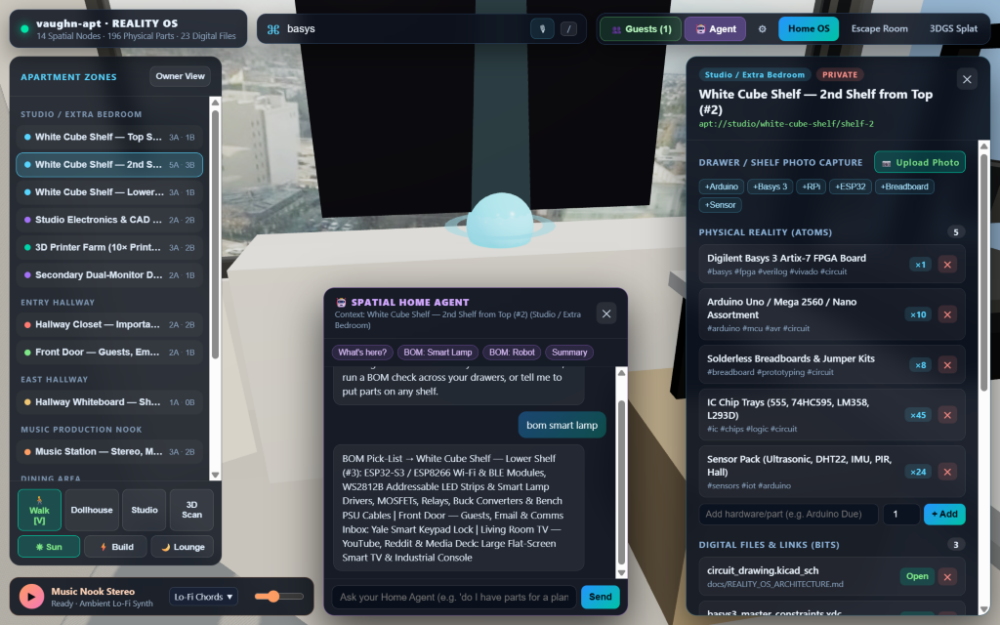
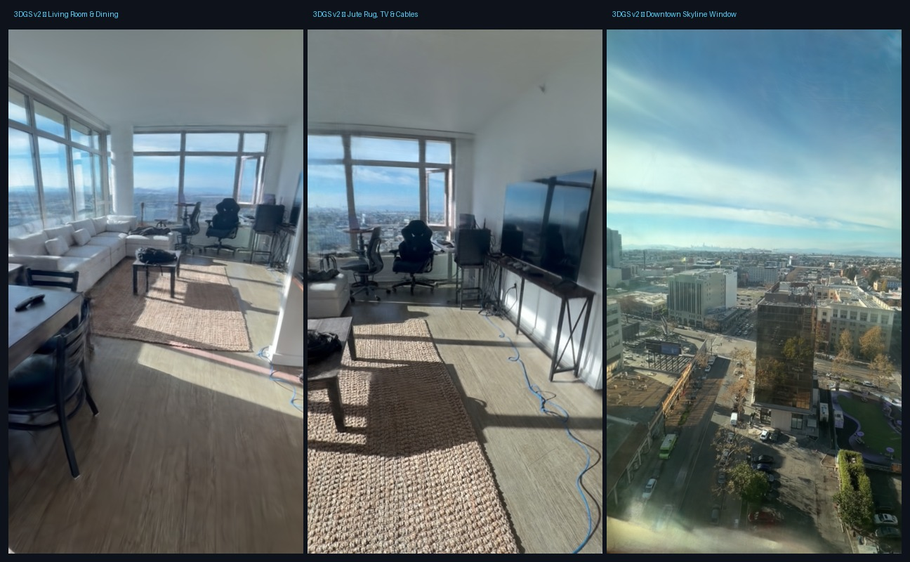
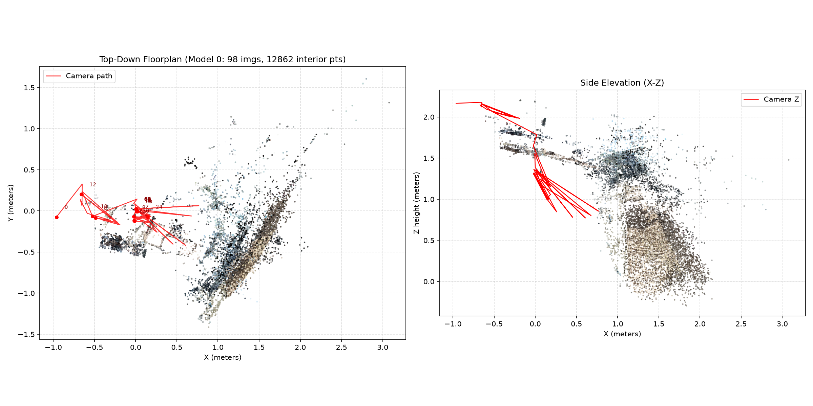

# vaughn-apt — Spatial Home OS, Cyber-Physical Reality Twin & 3D Apartment World

> *"Bridging the gap between digital and life is only a matter of interpretation — it's no longer about tangibility. If an app feels like home, you're more likely to stay and invite guests."*

**`vaughn-apt`** turns two handheld smartphone walkthrough videos (`IMG_6804.MOV` & `IMG_6805.MOV`) into a complete **Spatial Home OS & Cyber-Physical Reality Twin**, **modular Blender 5.3 level**, **crisp 25k-step 3D Gaussian Splat (3DGS)**, **game-engine exports (`.glb`/`.fbx`)**, and **playable Three.js First-Person Escape Room** — all running locally on Windows with zero paid cloud lock-in.

### Live Spatial Home OS (Verified Browser Capture)



---

## Complete 6-Phase Roadmap Status

| Phase | Milestone | Status |
| :--- | :--- | :--- |
| **Phase 0** | 3D Video Reconstruction (`pycolmap 4.2.1`), Crisp 25k-step Pinhole 3DGS (`Brush` on RTX 5070), Modular Blender 5.3 Level w/ Real Apartment Textures, `.glb`/`.fbx` Exports, & Playable 4-Clue Escape Room | ✅ Complete |
| **Phase 1** | **Spatial Home OS MVP** (`data/home_graph.json`, `apt://` unified atoms + bits addressing, `Ctrl+K` natural-language command bar & BOM parser, 3D fly-to spotlight, Living Room TV, persistent Music Nook Stereo, editable Hallway Whiteboard) | ✅ Complete |
| **Phase 2** | **Local Filesystem Bridge & Visual Capture** (mount & browse real Windows folders per room/closet, launch files natively on PC, live 3D Dining Wall Art texture swapper, Drawer/Shelf Photo Capture + optional Gemini Vision auto-tagging) | ✅ Complete |
| **Phase 3** | **Cyber-Physical Hardware Bridge** (real **WLED Pick-to-Light** shelf LEDs, **Klipper/Moonraker & OctoPrint** 3D printer telemetry hooks, Smart Lamp & HTTP webhook control) | ✅ Complete |
| **Phase 4** | **Room-Aware Spatial Agent (`Tab`)** — grounded in your active room/shelf, answers *"What's here?"*, runs multi-shelf project BOM feasibility checks, mutates inventory in plain English, and auto-upgrades to **Gemini 2.5 Flash** when `GEMINI_API_KEY` is set | ✅ Complete |
| **Phase 5** | **"Guests" & Social Presence** — Live 3D floating multiplayer Guest Avatars with nametags, server-side per-room privacy redaction (Vault & Studio locked for Guests with live Studio unlock switch), Front Door Comms Concierge w/ Web Audio doorbell chime, synced Living Room TV Co-Watch, Lounge Chat, & one-command `scripts/scan_my_home.py` runner | ✅ Complete |
| **Phase 6** | **Production Polish** — Native Web Speech **Voice Commands (`🎙`)**, seamless **Dollhouse ↔ First-Person Walk Mode (`V`)** inside Home OS, **Hardware/Gemini/Backup Setup Modal (`⚙`)** with gitignored `.env` key storage & LAN device poller, and verified zero-error browser E2E capture | ✅ Complete |

> Full system vision & schema specification: **[`docs/REALITY_OS_ARCHITECTURE.md`](docs/REALITY_OS_ARCHITECTURE.md)**

---

## Visual Tour (Blender 5.3 EEVEE Renders w/ Real Cropped Apartment Textures)

Every hero surface — the stitched downtown skyline outside the wrap-around windows, the woven jute rug, the framed tattooed-hands dining painting, the handwritten hallway whiteboard, and the entryway vinyl album art — was cropped directly from the walkthrough videos and embedded into `.blend` and `.glb`:

| Corner Living Room & Real Stitched Skyline | U-Shaped Kitchen, Dining & Real Wall Art |
| :---: | :---: |
|  |  |

| Studio / 3D-Printer Office & Foil Windows | Entry Hallway, Yale Smart Keypad & Bath |
| :---: | :---: |
|  |  |

---

## Photorealistic 3D Gaussian Splatting (Brush on RTX 5070)

The initial v1 3DGS baseline was blurry because it trained for only 8,000 steps on 98 sparse `SIMPLE_RADIAL` (un-rectified) frames. In **v2**, the reconstruction pipeline (`scripts/build_crisp_3dgs_dataset.py` + `scripts/postprocess_splat.py`) rebuilt a **4.3× denser, zero-distortion `PINHOLE` dataset** and trained **25,000 steps @ 1280 px** on an RTX 5070 before pruning floaters and gravity-aligning both splat positions and Gaussian quaternions:

| Metric | v1 Baseline (Blurry) | v2 Fixed (Crisp) |
| :--- | :--- | :--- |
| **Registered Views** | 98 frames (2 fps) | **209 ultra-sharp frames** (4 fps, Laplacian ≥ 111.8) |
| **Camera Model** | `SIMPLE_RADIAL` | **Exact `PINHOLE`** via `pycolmap.undistort_images` |
| **Initial 3D SfM Points** | 14,246 pts | **60,743 pts** (4,096 SIFT/img) |
| **Training Steps / Res** | 8,000 steps @ 1024 px | **25,000 steps @ 1280 px** (SSIM 0.25, SH deg 2) |
| **Post-Processing** | None | **Floater-pruned** (1.2M → **383,351 splats**, 55.6 MB) + **RANSAC gravity-aligned** |

### Before (v1) vs After (v2) Gaussian Splat Comparison


### v2 Crisp 3DGS Showcase Gallery (Rendered from `scan/splat/apartment_splat.ply`)


| Multi-Zone SfM Floorplan & Elevation | 3DGS v2 — Kitchen, Music Nook & Dining Lookback |
| :---: | :---: |
|  |  |

---

## Quick Start (3 Live 3D Experiences in One Local Server)

Double-click **`launch_walkthrough.bat`** or run:

```powershell
python scripts\home_os_server.py 8765
```

Then open any of the three synced 3D modes in your browser:
- **Spatial Home OS (Default):** `http://localhost:8765/web/home_os.html`
- **Playable Escape Room (First Person):** `http://localhost:8765/web/index.html`
- **Photorealistic 3D Gaussian Splat Viewer:** `http://localhost:8765/web/splat.html` *(or double-click `launch_brush_splat.bat` for native RTX GPU viewing)*
- **Live Multiplayer Guest Tab (Same PC or LAN Wi-Fi):** `http://localhost:8765/web/home_os.html?guest=1&name=Alex`

---

## Spatial Home OS — Feature Guide (`web/home_os.html`)

### 1. Unified Spatial Addressing (`apt://` Atoms + Bits)
Instead of flat desktop folders, every shelf, drawer, closet, desk, wall, stereo, TV, and 3D printer has one canonical spatial URI in `data/home_graph.json`:
- **`apt://studio/white-cube-shelf/shelf-2`** holds *both* your physical **Digilent Basys 3 FPGA, Arduino Uno/Mega/Nano kit, breadboards, 555/74HC595 ICs, and sensors** *and* your digital **`circuit_drawing.kicad_sch` & `basys3_master_constraints.xdc`**!
- **`apt://hall/closet`** is your private **Important Files Vault** (mounted to a real local folder on your PC, strictly redacted for Guests at the server API level).
- **`apt://studio/printers`** tracks your **10× 3D Printer Farm** with Moonraker/Klipper & OctoPrint telemetry hooks.
- **`apt://living/tv`**, **`apt://music/console`**, **`apt://dining/wall-art`**, **`apt://hall/whiteboard`**, **`apt://living/bistro`**, and **`apt://kitchen/coffee`** unite media, persistent room audio, pinned visual art, shared notes, world overview, and one-click lighting/routine scenes.

### 2. Command Bar (`/` or `Ctrl+K`) & Room-Aware Spatial Agent (`Tab`)
Try any of these natural-language commands right in the top bar or inside the **🤖 Agent** drawer:
- `where is my basys board` / `circuit drawing` → Flies the 3D camera straight to **Studio Shelf #2**, fires a pulsing 3D spotlight beam (plus real WLED Pick-to-Light LED if linked!), and opens Atoms + Bits side-by-side.
- `put Arduino Due x2 on studio shelf 2` → Immediately adds physical hardware to `data/home_graph.json`.
- `save motor_driver.kicad_sch to studio shelf 2` → Saves a digital artifact right onto that shelf.
- `bom smart lamp` / `bom robot` → Runs a **Bill of Materials feasibility scan** across all drawers & shelves so you know what parts you already own and exactly where to grab them.
- `what is here?` / `inventory summary` → Context-aware room summary (auto-upgrades to **Gemini 2.5 Flash** if `GEMINI_API_KEY` is set in your environment).

### 3. Local Filesystem, Live 3D Wall Art, Drawer Photos & IoT Hardware
- **Local Folder Mounting:** Mount any Windows folder (e.g., `docs`, `scripts`, `C:\Users\...`) to any closet or desk, browse files in 3D, click **Open** to launch natively on Windows, or **Pin** files onto that shelf.
- **Live 3D Wall Art Swap:** Click `apt://dining/wall-art` and upload any local image to dynamically swap the framed painting texture right inside the live Three.js apartment.
- **Drawer Photo Capture:** Upload a real photo of any open drawer/shelf to store a visual reference (and auto-detect parts via Gemini Vision if `GEMINI_API_KEY` is configured), plus one-click Maker Hardware quick-chips.
- **Hardware Bridge:** Link any **ESP32 WLED** IP (Pick-to-Light), **Moonraker/OctoPrint** 3D printer IP, or **Smart Lamp / Webhook** URL per spatial node and trigger real hardware straight from 3D.

### 4. Guests, Front Door Comms Concierge & Privacy (`👥 Guests`)
- **Live 3D Guest Avatars:** Click **↗ Open Guest Tab** (or share your LAN IP `http://<your-ip>:8765/web/home_os.html?guest=1&name=Maya`) to see real-time 3D floating capsule avatars + nametags gliding across the Living Room!
- **Server-Side Room Privacy:** `GET /api/graph?guest=1` strictly strips your **Hall Closet Vault** and **Studio Office** on the backend—Guests only see public rooms unless you click **🔓 Studio Unlocked** for a build collab.
- **Front Door Comms Concierge:** Click **🔔 Ring Doorbell** to test the two-tone Web Audio chime and Doorman auto-triage (`VIP → Living Room`, `Standard → Entryway`, `Promo/Spam → Held Outside`).
- **Synced Living Room TV Co-Watch & Lounge Chat:** Click **📡 Share to Room TV** on `apt://living/tv` to broadcast a synced YouTube watch-party banner to everyone currently in the apartment.

---

## Escape Room Mode (`web/index.html`)

Prefer a first-person puzzle game inside the apartment? Switch to **Escape Room** (`WASD` walk, `Mouse` look, `E` interact/open doors, `F` white flashlight, `U` UV blacklight, `P` toggle real COLMAP 3D scan overlay, `1–4` room teleports):
1. **Bistro Laptop + Windowsill Binoculars:** 4.5× optical zoom vignette scans the real downtown skyline for Digit #1.
2. **Music Nook MIDI Synth:** Play the live Web Audio **C-Major-7** arpeggio (`C → E → G → B`) to unlock Digit #2.
3. **Studio 3D Printer:** Animates the print head across the bed, prints & equips a collectible **UV Blacklight Lens**, and stamps Digit #3.
4. **Hallway Whiteboard + Yale Smart Keypad:** Activate UV Blacklight (`U`) to reveal hidden neon ink (Digit #4) and unlock the oak front entry door!

---

## Blender 5.3 Collections & Game-Engine Exports

Open **`blender/apartment_escape_room.blend`** (386 meshes, 45 PBR materials, 5 packed real photo textures, 10 organized Outliner collections including the toggleable 10,283-point `09_3DScan_Reference` cloud):
- **Godot 4 / Three.js / WebGL:** Import `exports/apartment_escape_room.glb` (1.44 MB self-contained glTF 2.0 with embedded textures and named `INTERACT_*` markers).
- **Unity / Unreal Engine 5:** Import `exports/apartment_escape_room.fbx` (embedded textures; all hinged doors have origins set cleanly on their hinge axes).

---

## REST API Reference (`scripts/home_os_server.py`)

| Method & Endpoint | Description |
| :--- | :--- |
| `GET /api/graph[?guest=1]` | Load full Home Graph (or server-redacted Guest Graph) |
| `POST /api/command` | Natural-language spatial search, `put/add` item, `save` file, or `bom <project>` check |
| `POST /api/agent` | Room-aware Spatial Agent (local offline engine + optional Gemini 2.5 Flash) |
| `POST /api/node/add-item` / `delete-item` | Add/remove physical hardware items (`Atoms`) |
| `POST /api/node/add-file` / `delete-file` | Attach/remove digital files or URLs (`Bits`) |
| `POST /api/node/notes` | Save persistent spatial notes / Hallway Whiteboard |
| `GET /api/fs/list?path=...` & `POST /api/node/mount-folder` | Browse & mount real local PC folders to any spatial node |
| `POST /api/open-local` | Launch a local PC file natively via Windows `os.startfile` |
| `POST /api/node/photo` & `POST /api/wall-art` | Upload drawer/shelf photos (+ optional Gemini Vision) or live 3D Wall Art |
| `POST /api/node/device` & `POST /api/device/trigger` | Link & trigger WLED Pick-to-Light, Moonraker/OctoPrint printers, or smart lamps |
| `GET/POST /api/presence/heartbeat`, `/api/chat`, `/api/tv/sync`, `/api/guest-access` | Phase 5 multiplayer 3D avatars, lounge chat, synced TV co-watch, and studio guest lock |
| `GET /api/inbox` & `POST /api/inbox/add` / `dismiss` | Front Door Comms Concierge & Doorman auto-triage |

---

## Repository Structure

```text
vaughn-apt/
├── README.md
├── launch_walkthrough.bat              # Starts Home OS Server + opens browser
├── launch_brush_splat.bat              # Opens apartment_splat.ply in native Brush GPU viewer
├── data/
│   └── home_graph.json                 # Persistent 14-node Spatial Home Graph (Atoms + Bits + IoT)
├── docs/
│   └── REALITY_OS_ARCHITECTURE.md      # Full Spatial Home OS & Reality Twin blueprint
├── blender/
│   └── apartment_escape_room.blend     # Editable Blender 5.3 scene (10 collections, packed textures)
├── exports/
│   ├── apartment_escape_room.glb       # glTF 2.0 (386 meshes, 45 materials, 5 embedded images)
│   └── apartment_escape_room.fbx       # FBX for Unity / Unreal Engine
├── renders/                            # Blender EEVEE renders + v1/v2 3DGS showcase comparisons
├── scan/
│   ├── floorplan_analysis.png          # Gravity-aligned SfM top-down & elevation plots
│   ├── living_scan_aligned.ply         # 10,283-point floor-aligned COLMAP point cloud
│   ├── living_scan_threejs.json        # WebGL point-cloud overlay dataset
│   ├── splat/apartment_splat.ply       # Crisp v2 25k-step floater-pruned, gravity-aligned 3DGS (55.6 MB)
│   └── splat_v2/eval_25000/            # 12 high-res 25k-step 3DGS eval renders
├── scripts/
│   ├── home_os_server.py               # Zero-dependency Spatial Home OS server (Phases 1–5)
│   ├── test_home_os.py                 # Automated Phases 1–5 backend test suite
│   ├── scan_my_home.py                 # One-command Scan-Your-Own-Home onboarding CLI
│   ├── extract_frames.py               # FFmpeg + OpenCV Laplacian blur filter
│   ├── run_sfm.py                      # Full-apartment multi-zone pycolmap SfM
│   ├── build_crisp_3dgs_dataset.py     # Dense 4096-SIFT SfM + zero-distortion PINHOLE undistorter
│   ├── postprocess_splat.py            # Binary PLY floater pruning & quaternion gravity alignment
│   ├── align_scan_to_level.py          # RANSAC floor-plane alignment for Blender/Three.js
│   └── build_apartment_blender.py      # Reproducible Blender 5.3 modular level generator
├── textures/                           # Real cropped skyline, rug, wall art, whiteboard & vinyl textures
└── web/
    ├── home_os.html / .css / .js       # Spatial Home OS (Phases 1–5 Complete)
    ├── index.html / styles.css / app.js# Playable First-Person Escape Room
    └── splat.html                      # Browser 3D Gaussian Splat Viewer
```

---

## Running Tests & Scanning Your Own Home

```powershell
# Run automated Phases 1–5 verification suite
.venv\Scripts\python.exe scripts\test_home_os.py
node --check web\home_os.js

# Turn ANY new smartphone walkthrough video into a crisp 3DGS + Spatial Home OS
.venv\Scripts\python.exe scripts\scan_my_home.py --video path\to\your_walkthrough.mov --steps 25000
```
