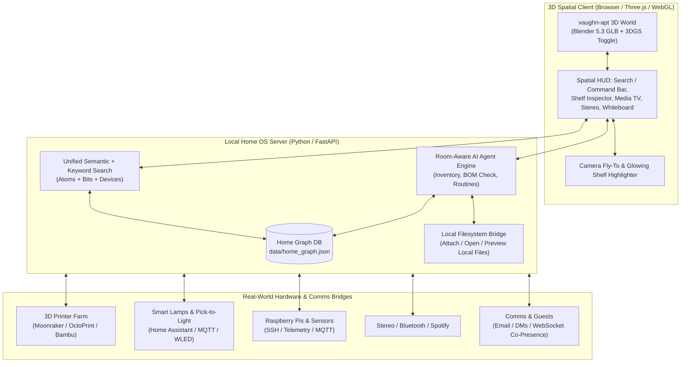

# Spatial Home OS & Cyber-Physical Reality Twin — Architecture & Phased Roadmap

> *"Bridging the gap between digital and life is only a matter of interpretation — it's no longer about tangibility. If an app feels like home, you're more likely to stay and invite guests."*

---

## 1. Core Thesis & Philosophy

Traditional operating systems force human memory into **flat, abstract hierarchies** (desktops, drives, nested folders). You forget where files live, lose context across dozens of browser tabs, and keep your digital work completely disconnected from your physical world (drawers full of microcontrollers, sensors, tools, printers, and smart hardware).

**vaughn-apt Reality OS** flips that paradigm by turning your actual 3D apartment into a **Unified Cyber-Physical Twin** powered by two foundational principles:

1. **Method of Loci (Spatial Permanence):** Humans evolved to remember *where* things live in 3D space. Important paperwork belongs in the **Hall Closet**; favorite media hangs visibly on the **Walls**; music lives at the **Stereo**; entertainment lives on the **Living Room TV**; making happens in the **Studio / Extra Bedroom**.
2. **Unified Spatial Addressing (Atoms + Bits Share One Address):** There is no artificial wall between a physical shelf and a digital folder. Saving your KiCad circuit drawing onto the **2nd shelf from the top in the extra room** puts it at the exact same address (`apt://studio/white-cube-shelf/shelf-2`) where your physical **Digilent Basys 3 FPGA, Arduinos, breadboards, ICs, and sensors** actually sit in real life.

When an AI agent shares this spatial model—knowing what is physically in every drawer, what digital files belong there, and what networked devices are running in each room—the computer gains **agency in your real life**.

---

## 2. Apartment Spatial Address Map (`apt://` URI Standard)

Every room, storage unit, surface, and appliance in `vaughn-apt` maps directly to a canonical `apt://` spatial URI and its corresponding Blender 5.3 mesh (`exports/apartment_escape_room.glb`):

| Spatial URI | Real Room & Mesh Reference | Physical World (Atoms) | Digital World (Bits) | Live Hardware / Agent Role |
| :--- | :--- | :--- | :--- | :--- |
| `apt://hall/closet` | Entry Hallway (`Door_LouveredCloset`) | Binders, legal/tax docs, emergency gear | **Vault:** encrypted docs, IDs, contracts, backups | **Archivist Agent** (private, PIN/auth locked) |
| `apt://hall/front-door` | Entry Hallway (`Door_FrontEntry`) | Yale smart lock, entryway mail/packages | **Guests Inbox:** emails, texts, DMs, social pings | **Doorman / Concierge Agent** (triages VIP vs noise) |
| `apt://dining/wall-art` | Dining Wall (`Din_WallArt_CanvasTop`) | Framed artwork & decor | **Pinned Favorites:** photos, vision boards, bookmarks | Ambient visual recall; swap frames with 1 click |
| `apt://music/console` | Music Nook (`Mus_MIDI_Body`, `Mus_Mixer`) | MIDI keyboard, mixer, DJ controller, monitors | **Audio Hub:** playlists, DAW stems, podcasts, Spotify | Persistent spatial/global audio + Bluetooth output |
| `apt://living/tv` | Living Room (`Liv_TV_Screen`) | Large flat-screen TV & console | **Media Hub:** YouTube, Reddit, Twitch, movies, feeds | Interactive media screen + guest co-watching |
| `apt://living/sectional` | Living Room (`Liv_Sectional_*`) | Modular corner sectional + rug | **Social Lounge:** active guest presence & hangouts | Public guest zone (private rooms stay locked) |
| `apt://living/bistro` | NW Corner Window (`Liv_BistroLaptop_Base`) | High-top bistro table, laptop, binoculars | **World Overview:** calendar, weather, analytics, news | Daily briefing & external world dashboard |
| `apt://hall/whiteboard` | East Wall (`Mus_Whiteboard_Surface`) | Physical dry-erase whiteboard | **Shared Memory:** persistent notes, kanban, agent plans | Always visible as you walk between rooms |
| `apt://kitchen/coffee` | Kitchen (`Kit_CoffeeMaker`, `Kit_Microwave`) | Espresso/coffee maker, appliances | **Daily Routines:** one-click morning/work automations | Triggers briefings, playlists, studio lighting |
| `apt://studio/white-cube-shelf/shelf-1..4` | Extra Room (`Off_CubeShelf`) | Arduinos, Basys FPGAs, Raspberry Pis, ICs, sensors, breadboards | **Hardware Docs:** KiCad schematics, Verilog, `.ino`, datasheets | Search highlights exact shelf in 3D + optional **WLED Pick-to-Light** |
| `apt://studio/west-desk` | Extra Room (`Off_WestDesk_Top`) | Stacked dual monitors, electronics bench | **Creation Workspace:** VS Code, Blender, CAD, active builds | **Builder Agent** (room-scoped coding & hardware help) |
| `apt://studio/east-desk` | Extra Room (`Off_EastDesk_Top`) | Dual-monitor secondary station, Raspberry Pi cluster | **Lab Compute:** SSH terminals, Pi services, Docker/servers | Live CPU/uptime/service status indicators |
| `apt://studio/printers/1..10` | Extra Room (`Off_3DPrinter1..2_*` + farm slots) | 10× 3D printers, filament spools, calibration tools | **Print Queue:** STL/3MF libraries, slicer profiles | Live **Klipper / Moonraker / OctoPrint / Bambu** telemetry & print dispatch |

---

## 3. System Architecture



---

## 4. The `home_graph.json` Data Schema

Every addressable location ("Node") in the apartment is stored in a clean, human-readable JSON graph that binds 3D coordinates and Blender mesh names to physical hardware, digital files, and networked devices:

```json
{
  "version": "1.0",
  "apartment": "vaughn-apt",
  "nodes": [
    {
      "id": "apt://studio/white-cube-shelf/shelf-2",
      "room": "Studio / Extra Bedroom",
      "label": "White Cube Shelf — 2nd Shelf from Top",
      "mesh_ref": "Off_CubeShelf",
      "position_threejs": [-2.62, 0.56, 5.62],
      "camera_view": { "pos": [-2.6, 1.35, 4.1], "look": [-2.62, 0.56, 5.62] },
      "privacy": "private",
      "category": "hardware_electronics",
      "physical_items": [
        { "name": "Digilent Basys 3 Artix-7 FPGA", "qty": 1, "tags": ["fpga", "basys", "verilog", "xilinx"] },
        { "name": "Arduino Uno / Mega / Nano Kit", "qty": 6, "tags": ["arduino", "mcu", "avr"] },
        { "name": "Solderless Breadboards & IC Chips (555, 74HC595, Op-Amps)", "qty": 12, "tags": ["breadboard", "ic", "circuit"] },
        { "name": "Sensor Assortment (Ultrasonic, DHT22, IMU, IR)", "qty": 18, "tags": ["sensors", "iot"] }
      ],
      "digital_files": [
        { "name": "circuit_drawing.kicad_sch", "path": "C:/Projects/electronics/circuit_drawing.kicad_sch", "type": "schematic" },
        { "name": "basys3_master.xdc", "path": "C:/Projects/fpga/basys3_master.xdc", "type": "constraints" }
      ],
      "notes": "Main microcontroller & FPGA prototyping shelf.",
      "live_devices": [
        { "type": "wled_pick_to_light", "host": "", "segment_id": 2, "enabled": false }
      ]
    }
  ]
}
```

---

## 5. Agentic Capabilities ("Agency in Your Actual Life")

1. **Natural-Language Spatial Memory:**
   - *"Put my Basys 3 board, 4 breadboards, and `circuit_drawing.pdf` on the second shelf from the top in the extra room."* → Parses location, updates `home_graph.json`, and glows the shelf in 3D.
2. **Instant Find & Fly-To:**
   - *"Where are my Raspberry Pis and 74HC595 shift registers?"* → Flies the camera directly to the matching shelf/drawer, highlights it in cyan, displays quantities + related digital schematics, and optionally triggers the real physical **WLED Pick-to-Light LED** under that shelf.
3. **BOM (Bill of Materials) Feasibility Assistant:**
   - *"I want to build a Bluetooth smart-lamp controller — what parts do I already own?"* → Cross-references your physical inventory across every drawer/shelf and generates a pick-list by exact apartment location + checks which of your 10 3D printers is idle to print the enclosure.
4. **Vision-Assisted Drawer Capture:**
   - Drop or snap a phone photo of any open drawer, bin, or shelf → Vision AI identifies every board, IC tube, sensor, and cable and proposes structured tags to confirm in one click.
5. **Room Privacy & Guest Agency:**
   - **Public Zones (Living Room, TV, Music Nook, Skyline):** Guests can hang out, queue songs on the stereo, and co-watch YouTube on the TV.
   - **Private Zones (Hall Closet Vault, Studio Office, Bathroom):** Locked by default—guests see a closed door unless you grant explicit room access.

---

## 6. Five-Phase Execution Roadmap

### Phase 1 — Spatial Home OS & Unified Inventory MVP *(Build Next!)*
**Goal:** Transform `vaughn-apt` from a static escape room into a working **Spatial Home OS** you can use every day, while preserving Escape Room mode alongside it.
- **Deliverables:**
  1. `data/home_graph.json` — Pre-seeded with all 12+ apartment zones (Hall Closet Vault, Dining Wall Art, Music Nook Stereo, Living Room TV, Front Door Guests, Whiteboard, Bistro Dashboard, Kitchen Routines, Studio Desks, 3D Printer Farm, and White Cube Shelf rows 1–4 pre-populated with sample Arduino/Basys/Pi/sensor entries you can edit).
  2. `scripts/home_os_server.py` — Lightweight local Python HTTP/JSON API server (`http://localhost:8765`) serving the 3D web app AND providing real read/write persistence to `data/home_graph.json` (`GET/POST /api/graph`, `POST /api/node/item`, `POST /api/node/file`, `POST /api/whiteboard`, `POST /api/open-local`).
  3. `web/home_os.html` + `web/home_os.js` — Full **Spatial Home OS Mode** built on `exports/apartment_escape_room.glb`:
     - **Global Command / Search Bar (`/` or `Ctrl+K`):** Search *anything* physical or digital (`"basys"`, `"circuit"`, `"taxes"`, `"youtube"`, `"printer"`) → smooth **camera fly-to** + **glowing 3D highlight beacon** on the exact shelf, drawer, or closet!
     - **Natural-Language Quick-Add:** Type *"add ESP32-S3 x4 to studio shelf 2"* or *"save circuit_drawing.pdf to studio shelf 2"* right in the bar to update your real apartment graph instantly.
     - **Interactive Zone Drawer / Inspector Panel:** Click or press `E` on any shelf, closet, desk, wall frame, TV, stereo, or whiteboard to view/add/edit physical items, digital files, and notes.
     - **Working Living Room TV Media Embed:** Load YouTube URLs / playlists / Reddit feeds right inside the Living Room TV overlay.
     - **Persistent Stereo Audio Player (Music Nook):** Background ambient/local audio & playlist controls that stay playing as you walk room-to-room.
     - **Live Persistent Hallway Whiteboard:** Edit markdown notes/tasks that save straight to `data/home_graph.json`.
  4. Mode switcher pill on both `web/index.html` (Escape Room), `web/home_os.html` (Home OS), and `web/splat.html` (3DGS Viewer).

### Phase 2 — Local Filesystem Bridge & Vision Drawer Capture
**Goal:** Connect real files on your PC and make inventorying real drawers effortless.
- **Deliverables:**
  1. Native local file/folder picker & launcher (`POST /api/open-local`) — clicking `circuit_drawing.kicad_sch` on Studio Shelf #2 opens it directly in KiCad/Blender/VS Code/Explorer.
  2. Hall Closet Vault mapped to a real local folder (e.g., `Documents/Vault`) with live file listing & previews.
  3. Wall Art Frame customizer — drag & drop any local image onto your real apartment walls and persist it.
  4. **Photo-to-Inventory Importer:** Upload a photo of any real drawer/shelf/bin → auto-generates an editable item list bound to that exact `apt://` shelf.

### Phase 3 — Live Cyber-Physical Hardware Bridge (IoT, 3D Printers, Pis, Pick-to-Light)
**Goal:** Give your 3D twin real physical control over your apartment's hardware.
- **Deliverables:**
  1. **3D Printer Farm Connector:** Adapter module supporting **Moonraker / Klipper**, **OctoPrint**, and **Bambu LAN** so all 10 printers show live status (Idle / Printing % / Temps) directly inside the Studio.
  2. **Smart Lamp & MQTT / Home Assistant Bridge:** Click any lamp or room scene in 3D to toggle real smart bulbs.
  3. **Physical Pick-to-Light (WLED / ESP32):** Optional webhook that lights up an addressable LED segment on your actual physical shelf when you search for a part in `vaughn-apt`.
  4. **Raspberry Pi & Sensor Telemetry:** Live temperature/humidity/CPU badges hovering over the room or desk where each Pi/sensor sits.

### Phase 4 — Room-Aware AI Agent & BOM Feasibility Engine
**Goal:** Bring true conversational & autonomous agency into the apartment.
- **Deliverables:**
  1. Context-aware AI chat/voice panel (`Tab`) that automatically injects the current room, selected shelf's physical inventory + digital files, and whiteboard tasks.
  2. **Project BOM Planner:** Ask *"What can I build with what's on Shelf 2?"* or *"Do I have parts for X?"* → generates an apartment pick-list with glowing 3D waypoints.
  3. **Ambient Task Indicators:** Background agent tasks visually glow on the Studio monitors or pin completed summaries onto the Hallway Whiteboard.

### Phase 5 — "Guests" (Comms Doorbell, Multiplayer Co-Presence & Scan-Your-Home)
**Goal:** Turn your personal twin into a living social home you can invite friends into.
- **Deliverables:**
  1. **Front Door Comms Concierge:** Surface unread emails, messages, and notifications at the Entryway with VIP vs. low-priority triage.
  2. **Live Guest Presence (WebSocket / WebRTC):** Share an invite link so friends enter your Living Room as avatars to co-watch YouTube on the TV, listen to music from your stereo, or brainstorm at the whiteboard—with per-room privacy locks keeping your Hall Closet and Studio private.
  3. **Generalized Scan-Your-Own-Home Pipeline:** One-command onboarding (`video → SfM → Brush 3DGS + Home Graph template`) so anyone can create their own Spatial Reality OS.

---

## 7. Immediate Next Step
Once this architecture document is pushed to `origin/main`, we move directly into **Phase 1** (`data/home_graph.json` + `scripts/home_os_server.py` + `web/home_os.html`) so you can walk through your apartment, click your extra room's shelves, save physical parts + digital files together, search `"basys"` or `"circuit"` with 3D fly-to highlighting, watch media on the TV, play stereo audio, and edit your live whiteboard!
